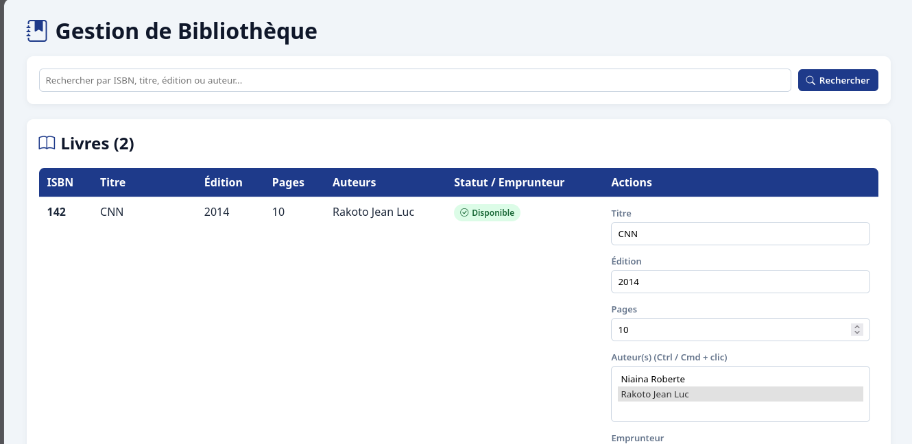
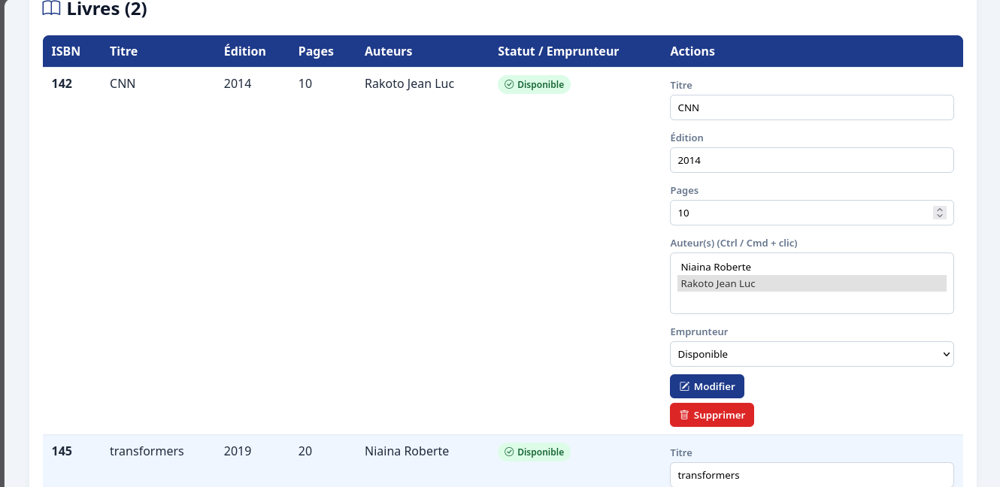
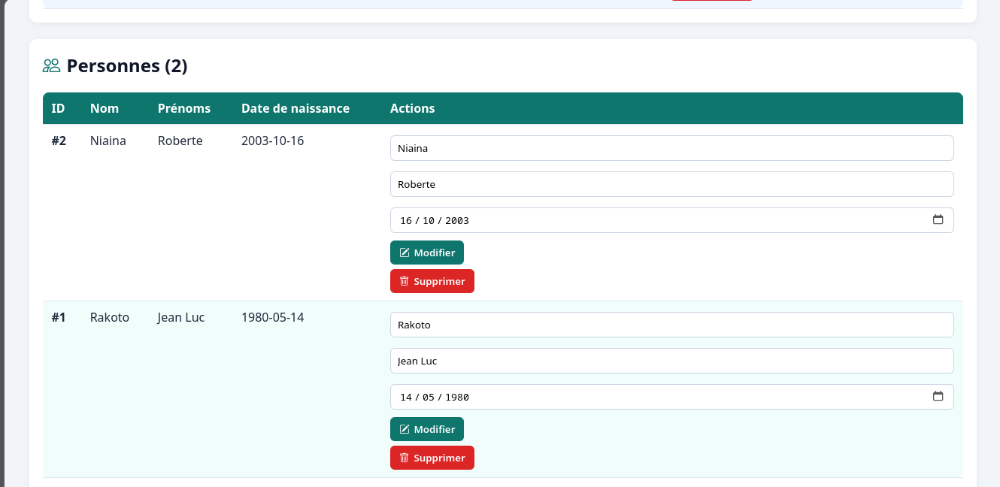
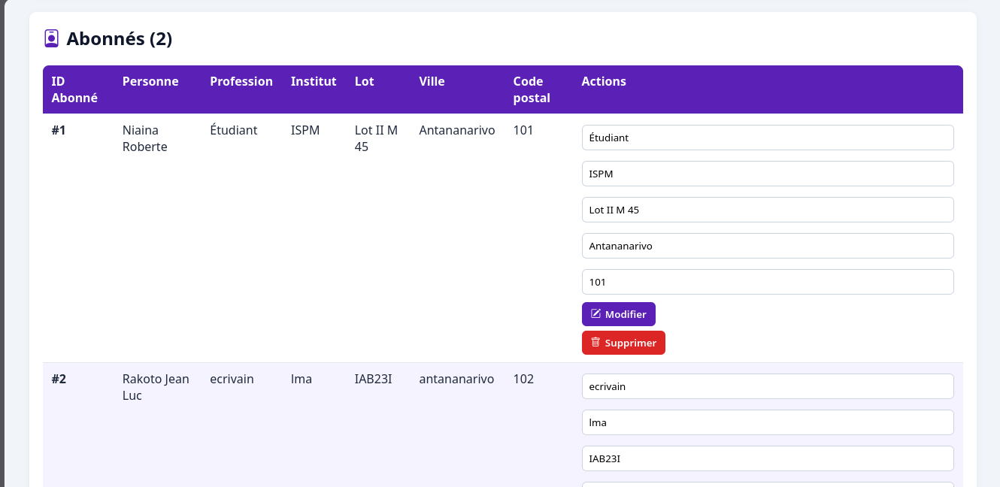

# Gestion de Bibliothèque (Laravel + PostgreSQL)

Application web de gestion de bibliothèque développée en binôme avec **Laravel 13**, **PHP 8.5.12** et **PostgreSQL** (`psql` 18.7). Elle permet de gérer les livres, les personnes, les abonnés, l'association multi-auteurs (`ecrire`) ainsi que le suivi des emprunts et la recherche multi-critères depuis une interface web.

AUTEURS:

-RANDRIANJAFY Voahanginiaina Roberte

-RAJAOVELONA Hidekela Fanaperantsoa

Dépôt GitHub : `https://github.com/niaina1610/dev_web`

---

## 1. Objectifs, problème à résoudre, technologies et fonctionnalités

### Problème à résoudre
Sans outil dédié, le suivi des livres, de leurs auteurs multiples, des abonnés et des emprunts peut entraîner des doublons, des incohérences lors de la suppression ou de la modification d'enregistrements, et des recherches lentes ou complexes en ligne de commande. L'application centralise ces données dans PostgreSQL tout en offrant une interface web accessible pour toutes les opérations courantes.

### Objectifs
- Centraliser la gestion du catalogue de livres, des personnes, des abonnés et des emprunts dans une base relationnelle PostgreSQL.
- Respecter l'intégrité des données via les contraintes SQL (`PRIMARY KEY`, `FOREIGN KEY`, `UNIQUE`, `CHECK`, `ON DELETE CASCADE`, `ON DELETE SET NULL`, `ON UPDATE CASCADE`) et traduire les erreurs PostgreSQL en messages compréhensibles.
- Proposer une interface claire avec tableaux colorés, icônes Bootstrap Icons et formulaires CRUD complets.

### Justification des technologies et outils
- **PostgreSQL (`psql` 18.7)** : choisi pour sa fiabilité relationnelle, le respect strict des contraintes (`PRIMARY KEY`, `FOREIGN KEY`, `UNIQUE`, `CHECK`), les actions référentielles (`ON DELETE CASCADE`, `ON DELETE SET NULL`, `ON UPDATE CASCADE`), les transactions et la recherche insensible à la casse (`ILIKE`).
- **Laravel 13 & PHP 8.5.12** : choisis pour organiser proprement le code (routes, contrôleurs, vues Blade), sécuriser les requêtes, gérer les transactions et afficher des messages d'erreur clairs en cas de violation de contrainte SQL.
- **Bootstrap Icons** : utilisé pour rendre l'interface lisible et rapide à parcourir lors de la démonstration.

### Fonctionnalités
- **Recherche (`GET /?q=...`)** : recherche insensible à la casse (`ILIKE`) sur l'ISBN, le titre, l'édition ou le nom/prénoms d'auteur, avec réinitialisation rapide.
- **Gestion des livres (`livre` et `ecrire`)** :
  - Ajout d'un livre (ISBN, titre, édition, nombre de pages, un ou plusieurs auteurs, emprunteur optionnel) dans une transaction SQL.
  - Modification d'un livre (titre, édition, nombre de pages, statut disponible/emprunté via `id_abonne` et mise à jour des auteurs dans `ecrire`).
  - Suppression d'un livre.
  - Affichage du statut (**Disponible** ou **Emprunté** avec le nom de l'abonné).
- **Gestion des personnes (`personne`)** :
  - Ajout, modification et suppression d'une personne (nom, prénoms, date de naissance).
- **Gestion des abonnés (`abonne`)** :
  - Enregistrement d'une personne existante comme abonné (profession, institut, lot, ville, code postal), avec contrainte d'unicité sur `id_personne`.
  - Modification et suppression d'un abonné.

---

## 2. Modèle Entité-Association (EA), Schéma Relationnel et Normalisation (BCNF)

### Modèle Entité-Association (EA)
- **PERSONNE** (`id_personne`, `nom`, `prenoms`, `date_de_naissance`)
- **ABONNE** (`id_abonne`, `profession`, `institut`, `lot`, `ville`, `code_postale`, `id_personne` *(UNIQUE, FK -> PERSONNE)*)
  - Une personne correspond au plus à un abonné (`0,1`), avec `ON DELETE CASCADE` et `ON UPDATE CASCADE`.
- **LIVRE** (`isbn`, `titre`, `edition`, `nombre_de_page`, `id_abonne` *(FK -> ABONNE)*)
  - Un livre peut être emprunté par au plus un abonné (`0,1` côté livre, `0,N` côté abonné), avec `ON DELETE SET NULL` et `ON UPDATE CASCADE`.
- **ÉCRIRE** (`isbn` *(PK, FK -> LIVRE)*, `id_personne` *(PK, FK -> PERSONNE)*)
  - Association `N..N` entre `PERSONNE` et `LIVRE` : un livre peut avoir un ou plusieurs auteurs, et une personne peut être liée à un ou plusieurs livres, avec `ON DELETE CASCADE` et `ON UPDATE CASCADE`.

### Schéma relationnel

```sql
personne (
    id_personne INT GENERATED ALWAYS AS IDENTITY PRIMARY KEY,
    nom VARCHAR(100) NOT NULL,
    prenoms VARCHAR(150) NOT NULL,
    date_de_naissance DATE
)

abonne (
    id_abonne INT GENERATED ALWAYS AS IDENTITY PRIMARY KEY,
    profession VARCHAR(120),
    institut VARCHAR(150),
    lot VARCHAR(100),
    ville VARCHAR(100) NOT NULL,
    code_postale VARCHAR(20),
    id_personne INT NOT NULL UNIQUE,
    CONSTRAINT fk_abonne_personne
        FOREIGN KEY (id_personne) REFERENCES personne(id_personne)
        ON DELETE CASCADE
        ON UPDATE CASCADE
)

livre (
    isbn VARCHAR(20) PRIMARY KEY,
    titre VARCHAR(255) NOT NULL,
    edition VARCHAR(120),
    nombre_de_page INT NOT NULL CHECK (nombre_de_page > 0),
    id_abonne INT NULL,
    CONSTRAINT fk_livre_abonne
        FOREIGN KEY (id_abonne) REFERENCES abonne(id_abonne)
        ON DELETE SET NULL
        ON UPDATE CASCADE
)

ecrire (
    isbn VARCHAR(20) NOT NULL,
    id_personne INT NOT NULL,
    PRIMARY KEY (isbn, id_personne),
    CONSTRAINT fk_ecrire_livre
        FOREIGN KEY (isbn) REFERENCES livre(isbn)
        ON DELETE CASCADE
        ON UPDATE CASCADE,
    CONSTRAINT fk_ecrire_personne
        FOREIGN KEY (id_personne) REFERENCES personne(id_personne)
        ON DELETE CASCADE
        ON UPDATE CASCADE
)
```

### Dépendances fonctionnelles et normalisation (BCNF)

Une relation est en **forme normale de Boyce-Codd (BCNF)** si, pour toute dépendance fonctionnelle non triviale $X \rightarrow Y$, $X$ est une super-clé de la relation.

- **`personne` (`id_personne`, `nom`, `prenoms`, `date_de_naissance`)**
  - Dépendances fonctionnelles : `id_personne -> nom, prenoms, date_de_naissance`.
  - Clé candidate : `id_personne`. Comme le déterminant est la clé primaire, la table est en **BCNF**.
- **`abonne` (`id_abonne`, `profession`, `institut`, `lot`, `ville`, `code_postale`, `id_personne`)**
  - Dépendances fonctionnelles : `id_abonne -> profession, institut, lot, ville, code_postale, id_personne` et `id_personne -> id_abonne` (contrainte `UNIQUE`).
  - Clés candidates : `id_abonne` et `id_personne`. Chaque déterminant est une clé candidate, la relation est donc en **BCNF**.
- **`livre` (`isbn`, `titre`, `edition`, `nombre_de_page`, `id_abonne`)**
  - Dépendances fonctionnelles : `isbn -> titre, edition, nombre_de_page, id_abonne`.
  - Clé candidate : `isbn`. Le seul déterminant est la clé primaire, la relation est donc en **BCNF**.
- **`ecrire` (`isbn`, `id_personne`)**
  - Clé primaire : `(isbn, id_personne)`. Il n'y a pas d'attribut non clé et aucune dépendance fonctionnelle non triviale entre sous-ensembles de la clé ; la relation est donc en **BCNF**.

---

## 3. Étapes d'installation, de configuration et de lancement

### Prérequis et vérification de l'environnement
- **PHP** (8.5.12) et **Composer** (2.11.2) installés.
- Extensions PHP **`PDO`**, **`pdo_pgsql`** et **`pgsql`** activées.
- **PostgreSQL** installé et actif.

Vérifier PHP, les extensions PostgreSQL et Composer :

```bash
php -v
php -m | grep -iE 'pdo_pgsql|pgsql'
composer -V
```

### Installation et configuration

```bash
cd ~
git clone [https://github.com/niaina1610/dev_web.git](https://github.com/niaina1610/dev_web.git) gestion-bibliotheque
cd gestion-bibliotheque
composer install
php -r "file_exists('.env') || copy('.env.example', '.env');"
php artisan key:generate
```

Configurez ensuite la connexion PostgreSQL dans `.env` :

```env
DB_CONNECTION=pgsql
DB_HOST=127.0.0.1
DB_PORT=5432
DB_DATABASE=gestion_bibliotheque
DB_USERNAME=postgres
DB_PASSWORD=votre_mot_de_passe

SESSION_DRIVER=file
```

Videz le cache de configuration et des vues :

```bash
php artisan optimize:clear
```

### Lancement

```bash
php artisan serve
```

Accédez ensuite à **`http://127.0.0.1:8000`**.

---

## 4. Instructions pour créer et remplir la base de données

Placez le script SQL de création et d'initialisation dans `database/sql/init_bibliotheque.sql` (ou exécutez directement les commandes `psql` ci-dessous).

### Création de la base et des tables sous `psql`

```bash
sudo -u postgres psql
```

Dans l'invite `postgres=#` :

```sql
CREATE DATABASE gestion_bibliotheque ENCODING 'UTF8';
\c gestion_bibliotheque

CREATE TABLE personne (
    id_personne INT GENERATED ALWAYS AS IDENTITY PRIMARY KEY,
    nom VARCHAR(100) NOT NULL,
    prenoms VARCHAR(150) NOT NULL,
    date_de_naissance DATE
);

CREATE TABLE abonne (
    id_abonne INT GENERATED ALWAYS AS IDENTITY PRIMARY KEY,
    profession VARCHAR(120),
    institut VARCHAR(150),
    lot VARCHAR(100),
    ville VARCHAR(100) NOT NULL,
    code_postale VARCHAR(20),
    id_personne INT NOT NULL UNIQUE,
    CONSTRAINT fk_abonne_personne
        FOREIGN KEY (id_personne) REFERENCES personne(id_personne)
        ON DELETE CASCADE
        ON UPDATE CASCADE
);

CREATE TABLE livre (
    isbn VARCHAR(20) PRIMARY KEY,
    titre VARCHAR(255) NOT NULL,
    edition VARCHAR(120),
    nombre_de_page INT NOT NULL CHECK (nombre_de_page > 0),
    id_abonne INT NULL,
    CONSTRAINT fk_livre_abonne
        FOREIGN KEY (id_abonne) REFERENCES abonne(id_abonne)
        ON DELETE SET NULL
        ON UPDATE CASCADE
);

CREATE TABLE ecrire (
    isbn VARCHAR(20) NOT NULL,
    id_personne INT NOT NULL,
    PRIMARY KEY (isbn, id_personne),
    CONSTRAINT fk_ecrire_livre
        FOREIGN KEY (isbn) REFERENCES livre(isbn)
        ON DELETE CASCADE
        ON UPDATE CASCADE,
    CONSTRAINT fk_ecrire_personne
        FOREIGN KEY (id_personne) REFERENCES personne(id_personne)
        ON DELETE CASCADE
        ON UPDATE CASCADE
);
```

### Remplissage initial des tables pour tester

```sql
INSERT INTO personne (nom, prenoms, date_de_naissance) VALUES
('Rakoto', 'Jean Luc', '1980-05-14'),
('Niaina', 'Roberte', '2003-10-16');

INSERT INTO abonne (profession, institut, lot, ville, code_postale, id_personne) VALUES
('Étudiant', 'ISPM', 'Lot II M 45', 'Antananarivo', '101', 2);

INSERT INTO livre (isbn, titre, edition, nombre_de_page, id_abonne) VALUES
('978-2-212-12345-6', 'Introduction aux bases de données', 'Eyrolles', 320, NULL),
('978-2-10-078910-2', 'Algorithmique pratique', 'Dunod', 410, 1);

INSERT INTO ecrire (isbn, id_personne) VALUES
('978-2-212-12345-6', 1),
('978-2-10-078910-2', 1);

SELECT * FROM livre;
exit
```

*(Si vous utilisez un fichier `database/sql/init_bibliotheque.sql` contenant ces instructions, vous pouvez l'exécuter avec : `sudo -u postgres psql -d gestion_bibliotheque -f database/sql/init_bibliotheque.sql`.)*

---

## 5. Captures d'écran

### Recherche et vue générale


### Tableau des livres, auteurs et emprunts


### Tableau des personnes


### Tableau des abonnés


### Formulaires d'ajout


---

## 6. Étapes pour tester l'application et reproduire la démonstration

1. **Vérifier la connexion à la base depuis Laravel** :

```bash
php artisan tinker --execute="DB::connection()->getPdo(); echo 'Connexion OK : ' . DB::table('livre')->count() . ' livre(s)';"
```

2. **Affichage** : ouvrir `http://127.0.0.1:8000` et vérifier l'affichage des livres (`Introduction aux bases de données`, `Algorithmique pratique`), des personnes et des abonnés.
3. **Recherche** : taper un titre, un ISBN, une édition ou un nom d'auteur dans la barre de recherche, valider avec **Rechercher**, puis cliquer sur **Réinitialiser**.
4. **Ajout** :
   - Créer une personne dans *Ajouter une personne*.
   - Créer un abonné associé à cette personne dans *Ajouter un abonné*.
   - Ajouter un livre avec ses champs et un ou plusieurs auteurs dans *Ajouter un livre*.
5. **Modification** : modifier un livre (titre, pages, auteur(s) ou emprunteur), une personne ou un abonné, puis cliquer sur **Modifier**.
6. **Suppression et contraintes** : supprimer un livre de test ; tester l'ajout d'un doublon (même ISBN ou personne déjà abonnée) pour vérifier que le message d'erreur PostgreSQL s'affiche proprement.
